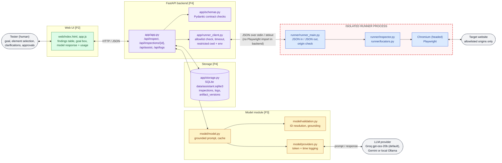
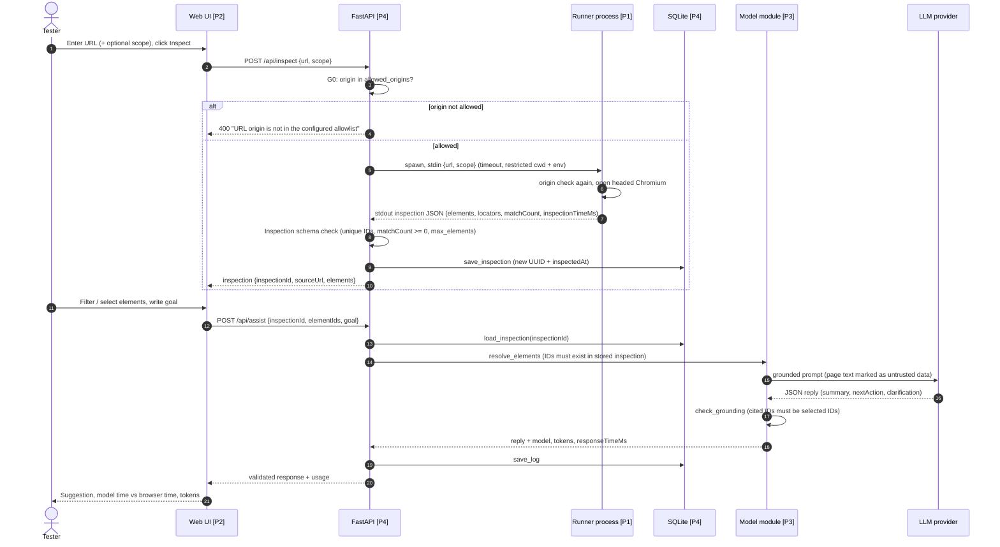
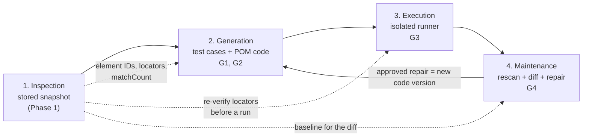

# Web Testing Assistant: Phase 1 Design Document

Human-in-the-loop assistant that helps a tester inspect a web page, design tests, generate Playwright code, run approved tests and maintain them after the page changes. Phase 1 delivers the architecture and a working guided inspection. Full detail per topic: [`docs/sections/`](sections/).

**Rules the design follows:** free-tier or local models only; every output cites elements that were actually observed; page content is data, never instructions; the browser runs in a separate process limited to approved targets; every inspection is stored so later steps use what was really observed.

## 1. Component diagram

Colours show ownership: P1 blue (runner), P2 green (UI), P3 amber (model), P4 purple (backend/storage). The red dashed box is the isolated runner.

| Component | Responsibility |
|---|---|
| Web UI (`web/`) | URL input, findings linked to the source URL, element selection, goal box, model answer with usage. |
| FastAPI backend (`app/`) | Only entry point. Allowlist check, schema validation, orchestration, error mapping (400/404/503/504). |
| Storage (`app/storage.py`) | SQLite: inspections, model-call logs, artifact versions. |
| Model module (`model/`) | Grounded prompt, provider call, output validation, token and time logging. |
| Runner (`runner/`) | Separate process. JSON in on stdin, headed Chromium via Playwright, JSON out on stdout. |

**Boundaries.** *Isolation:* the backend never imports Playwright; it only exchanges JSON with the runner, so a browser crash or hang cannot take down the API. *Trust:* page text is untrusted, truncated and placed in a delimited data block before reaching the model. *Secrets:* API keys live in a git-ignored `.env` and are not passed to the runner.

## 2. Data flow

1. The tester submits a URL (optionally a scope: CSS selector and element types). The backend checks scheme, credentials-in-URL and origin against the allowlist (G0) before any browser starts.
2. The backend starts the runner with a timeout, a restricted working folder and a minimal environment. The runner re-checks the origin, opens visible Chromium and returns elements, labels, attributes and ranked locators with live match counts, plus browser time.
3. The backend validates the output against the `Inspection` schema (unique element IDs, `matchCount >= 0`, `max_elements`), stores it with a new UUID and timestamp, and returns it. Invalid output is never stored.
4. The tester filters and selects elements and writes a goal. The backend loads the stored inspection and accepts only element IDs that exist in it.
5. The model receives the goal and the selected records only. Its reply is checked: every cited element ID must be one of the selected IDs; unknown IDs are flagged, not hidden.
6. The call is logged (model, input/output tokens, real or labelled estimate, model response time) and returned. Browser time and model time are reported separately.

**Errors:** a refused URL returns 400 and never opens a browser; a runner timeout returns 504; a runner contract violation returns 400 with nothing stored; an unknown inspection or element ID returns 404/400; provider failure or rate limit returns 503.

## 3. Approval gates and validation

```mermaid
%% Approval gates along the full workflow. G0 is enforced in Phase 1; G1-G4 are Phase 2.
flowchart LR
  URL["Tester enters URL"] --> G0{{"G0 Target approval<br/>allowlisted origin"}}
  G0 -->|approved| INSP["Inspection<br/>(stored snapshot)"]
  G0 -->|refused| STOP0(["400, browser never opens"])
  INSP --> GEN["Draft test cases<br/>(stored element IDs only)"]
  GEN --> G1{{"G1 Test plan approval<br/>edit / clarify / approve"}}
  G1 -->|approved| CODE["Generate POM code<br/>+ syntax and locator checks"]
  G1 -->|changes| GEN
  CODE --> G2{{"G2 Code review"}}
  G2 -->|approved| G3{{"G3 Execution approval<br/>explicit go"}}
  G2 -->|changes| CODE
  G3 -->|go| RUN["Run in isolated runner<br/>store outcome + screenshots"]
  RUN --> RESCAN["Rescan page<br/>diff vs stored inspection"]
  RESCAN --> REP["Proposed locator repairs<br/>with evidence"]
  REP --> G4{{"G4 Repair approval<br/>one repair at a time"}}
  G4 -->|approved| CODE
  G4 -->|rejected| KEEP(["Keep current code,<br/>flag test"])

  classDef gate fill:#fee2e2,stroke:#b91c1c,color:#7f1d1d
  classDef phase1 fill:#ede9fe,stroke:#6d28d9,color:#4c1d95
  class G0,G1,G2,G3,G4 gate
  class URL,INSP phase1
```

| Gate | Phase | The tester approves | Checked before the tester sees it |
|---|---|---|---|
| **G0** Target | 1 (enforced) | The page to inspect; only allowlisted origins open. | Scheme, no credentials in URL, origin allowlist, checked in the backend and again in the runner. |
| **G1** Test plan | 2 | Test cases (steps, expected results), after edits and clarification. | Steps cite stored element IDs only; unknown behaviour becomes a question. |
| **G2** Code review | 2 | Generated Playwright POM code. | Syntax check; each locator re-checked against the stored inspection (`matchCount == 1`). |
| **G3** Execution | 2 | An explicit "run". | Only approved code versions run, in the isolated runner. |
| **G4** Repair | 2 | Each locator repair, one at a time, with evidence. | Rescan diff; ambiguous matches are asked about, never chosen silently. |

**Validation implemented in Phase 1:** URL scope (G0); runner output schema; locator uniqueness recorded as `matchCount` and `unique`; selected IDs must exist in the stored inspection; model output grounding check; page text treated as untrusted data. **Human interaction in Phase 1:** testing goal and element selection in the UI; scope and clarification answers are supported by the API and runner.

## 4. Model integration

Providers sit behind one interface: Groq free tier with open-weights `openai/gpt-oss-20b` (default), Gemini free tier, or local Ollama. **Two-step fallback:** if the configured provider fails (network error, rate limit, timeout), the call falls back first to local Ollama and then to an offline `mock` provider, so the demo keeps working without a key or network. Each call is logged with the provider that actually answered. The `mock` provider is for tests and offline demos only and is never evidence. The system prompt requires grounding in observed data, separates observations from assumptions and asks one clarification question when expected behaviour is unknown. Each call records provider, model version, tokens (provider counts or labelled estimates), model-only response time and a cache flag in the `logs` table; `GET /api/logs` returns every call and the average fresh response time. The same provider layer will serve test-case generation, POM generation and repair suggestions in Phase 2.

## 5. Isolated runner

The runner (`runner/`) is the only component that touches a browser or the target site.

**Process boundary.** The backend (`app/runner_client.py`) starts `python -m runner.runner_main` as a separate process. It passes one JSON request `{url, scope}` on stdin and reads one JSON result on stdout, or `{"error": ...}` with a non-zero exit code. The process runs with a timeout (`runner_timeout_seconds`, 30 s), working folder `data/runner_work/` and an environment allowlist (no API keys). The backend never imports Playwright or runner code.

**Inspection steps (`inspector.py`).**
1. Check the URL origin against `allowed_origins`.
2. Launch **headed** Chromium (`headless=False`) in a fresh browser context and load the page (20 s navigation timeout).
3. Check the origin again on the final URL after loading. A redirect to a non-allowlisted origin is rejected (tested with a redirect from `localhost:8000` to `127.0.0.1:8000`).
4. Apply the scope, collect the **visible** matching elements and, for each, read its role, label, text and attributes.
5. Build candidate locators, count each on the live page and rank them.
6. Close the context and browser in all cases, including errors.

**Scope.** `scope.types` limits element kinds (`button`, `link`, `input`, `textarea`, `select`, `form`); without it all six are collected. `scope.selector` limits the region to a CSS selector; a selector that matches nothing is an error.

**Observed data per element.** Role, tag, label, `labelSource`, visible text and attributes (id, name, type, role, href, placeholder, aria-label, title, data-testid, required, disabled, checked, readonly, multiple). The label is the first available of aria-label, `label[for]`, wrapping label, placeholder, title, visible text, value, name; `labelSource` records which one was used, so labels can be traced to real page evidence.

**Candidate locators.** Up to five per element, built only from observed attributes: `testid`, `id`, `role` + accessible name, `label`, and a CSS fallback. Each carries `matchCount` and `unique` (`matchCount == 1`), counted on the live page. Ranking (`locators.py`): candidates that match exactly one element come first, then the order role, label, test id, id, CSS. Candidates that match zero or several elements are kept and ranked last, so later phases can see that they are unsafe rather than never hearing about them.

**Timing.** `inspectionTimeMs` is browser time only, including browser start-up, and is kept separate from model time.

**Known limits** (also listed in section 10):
- Only the initial and final URLs are checked. Sub-requests while the page loads are not blocked; a test page that embedded an image from another local origin made the browser request it.
- The `form` element's label is the whole form's text, so forms make poor selection targets (select inputs and buttons instead).
- A `select` is labelled by its first option when it has no label.

## 6. Web UI and human interaction

The UI (`web/index.html`, `app.js`, `style.css`) is plain HTML and JavaScript served by the FastAPI app at `/`, with no framework and no build step. It talks only to the backend (`/api/inspect`, `/api/assist`), never to the runner or the model.

**Workflow.**
1. **Inspect.** The tester enters a URL and clicks **Inspect page**. The UI sends `POST /api/inspect {url}` and shows progress and any error (refused URL, timeout, runner error). **Load sample** shows a bundled example without a browser; it is tagged *Sample* and cannot be used for model calls.
2. **Findings.** A summary shows the element count, locator candidate count and inspection time. A tag marks the result *Live* and shows the source URL. Each element is a row with a checkbox, its label, role and ID. An **Evidence** button expands the observed attributes and the candidate locators with strategy and match count (for example "role · 2 matches"), so duplicates are visible.
3. **Goal and selection.** The tester ticks elements and writes a testing goal. **Suggest next step** stays disabled until there is a live inspection, at least one selected element and a goal, and a hint says which is missing. Inputs are locked while a request is running.
4. **Model answer.** The UI sends `POST /api/assist {inspectionId, elementIds, goal}`. The returned message is shown with the model name, model response time and input and output tokens, with a note when the counts are estimates. If the model needs more information, its clarification question appears in that message.
5. Changing the selection or goal clears the previous answer, so an answer is never shown next to a different selection.

**How this meets the approval and grounding rules.** The model is only asked about elements the tester selected from a stored inspection. Selection is by ID, and the backend rejects IDs that are not in that inspection. Page text is rendered with `textContent`, never as HTML.

## 7. Storage

SQLite (`data/assistant.sqlite3`, git-ignored): one file, no server, works from a fresh clone, enough for one tester on one machine. Each record keeps its full JSON payload plus indexed columns, so the contract can grow without schema changes.

| Table | Content |
|---|---|
| `inspections` | Immutable snapshot per inspection (UUID, source URL, timestamp, full JSON). A rescan adds a new row, so old snapshots stay available for diffs. |
| `logs` | One row per model call: goal, selected IDs, model, tokens, response time, cache flag, grounding result. |
| `artifact_versions` | Versioned test cases and code (Phase 2). Restore saves an old payload as a new version, so history is never rewritten. |

Planned for Phase 2: `runs` (approved executions, outcomes, screenshot paths) and `repairs` (proposed repairs and the tester's decision). Writes use transactions that roll back on error, and runner output is validated before it is stored.

## 8. From inspection to generation, execution and maintenance

The stored inspection is the single source of truth. Nothing downstream may invent an element.

| Step | Uses from the stored inspection | Result |
|---|---|---|
| Generation | Element IDs and locators with `unique` | Test cases cite stored IDs only (G1); POM code prefers locators proven unique and is syntax- and locator-checked (G2). |
| Execution | Locators as the expected page state | Locators are re-verified before a run, so drift is reported instead of producing false failures (G3). |
| Maintenance | The previous snapshot of the same URL as baseline | Rescan, diff (added, removed, changed elements), evidence-backed repair candidates, clarification when ambiguous (G4); each approved repair becomes a new code version. |

## 9. Resource assumptions

| Item | Value |
|---|---|
| Machine | Windows 11 Pro, Intel Core i7-13650HX, 16 GB RAM, RTX 4050 Laptop GPU (used only with local Ollama) |
| Software | Python 3.12, FastAPI, Pydantic, Playwright 1.61 with headed Chromium |
| Model | Groq free tier, `openai/gpt-oss-20b`, temperature 0.2, max 1500 output tokens, 60 s timeout; fallback chain: local Ollama `llama3.2:3b`, then offline `mock` |
| Rate limits | Free-tier per-minute and per-day limits apply. A rate-limit error returns 503. **TODO:** copy the exact values from the Groq console at evidence time. |
| Runner | `allowed_origins` in `config/settings.yaml`, 30 s timeout, max 200 elements, working folder `data/runner_work/`, minimal environment without API keys |

Assumptions: one tester, one machine, one inspection at a time; small to medium pages; network access for the model API; a visible desktop session for the headed browser. Time measurements: browser time is `inspectionTimeMs`; model time is `responseTimeMs` per call, excluding browser time.

## 10. Limitations and status

- The runner is a separate OS process, not an OS sandbox; it runs as the same user. Network scope relies on the allowlist: the origin is checked before launch and on the final URL after load, but in-page navigations and sub-requests are **not blocked while the page loads** (P1).
- Implemented: G0, URL and schema validation, headed inspection with locators and match counts, storage, grounded model call with logging, element selection and goal.
- Phase 2: G1-G4, test generation, execution, rescan and repair, versioning with diffs.

*Sources: [`sections/`](sections/) (full text) and [`diagrams/`](diagrams/) (editable Mermaid).*
