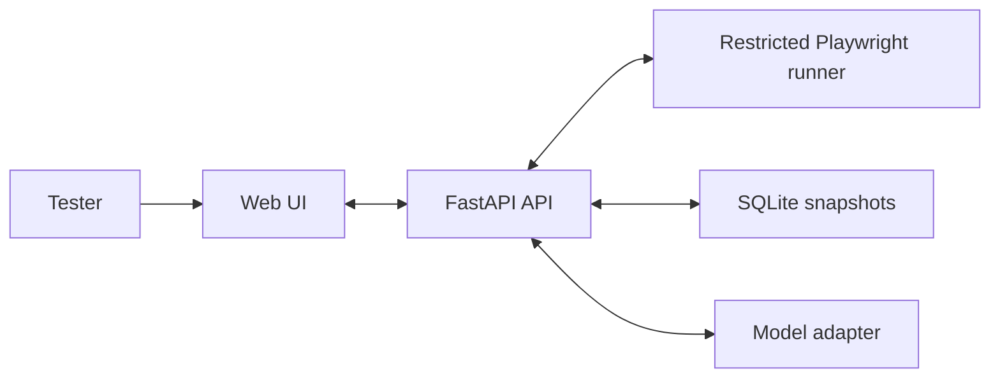

# Phase 1 architecture draft

## Data flow

1. The tester submits an approved demo URL. The API validates it and starts
   the inspector in a separate process with a timeout.
2. The worker opens headed Chromium and returns observed elements and
   candidate locators. The API saves the snapshot and returns its ID and data.
3. The tester selects elements and enters a goal. The API resolves those IDs
   from the stored snapshot and submits the selected evidence to the model.
4. The UI shows the suggestion and the measured model usage.

## Model integration (Person 3)

- **Providers:** free-tier Groq (default, `llama-3.1-8b-instant`), Gemini free tier, or a local Ollama model, behind one interface (`model/providers.py`) with an automatic fallback. No paid APIs. Keys live only in a local `.env`.
- **Prompt:** the system prompt (`model/prompts/inspect_assist.txt`) requires grounding in observed data, separates observations from assumptions, and asks one clarification question when expected behavior is unknown. The user prompt contains the tester goal, the selected IDs and the selected element records only.
- **Prompt-injection guard:** page-derived strings are truncated and placed in an `<observed_page_data>` block declared as untrusted data; attempts to close the block from page text are neutralised.
- **Validation:** inputs must be IDs from the stored inspection (`resolve_elements`). Outputs are parsed as JSON and every cited element ID, in structured fields or free text, is checked against the selected IDs; unknown IDs are flagged, not hidden. Unparseable replies are reported with the raw text.
- **Usage evidence:** each call records provider, model/version, input/output tokens (provider counts, or labelled estimates), model-only response time, cache flag, goal and selected IDs in the `logs` table. `GET /api/logs` returns per-call data and the average fresh response time.
- **Path to Phase 2:** the same provider layer and validation will serve test-case generation (`prompts/testcase_gen.txt` draft), POM code generation and locator-repair suggestions, each followed by a tester approval gate.

## Phase 2 plan

Use saved inspections and tester requirements to draft test cases with actions
and meaningful expected results. Ask the tester to clarify missing behavior
and approve the plan. Generate Playwright Page Object Model code, validate
syntax and locator matches, allow code review, and require explicit execution
approval. Run the approved tests in a restricted worker and retain outcomes,
screenshots, and failure details. After a rescan, compare snapshots, ask about
ambiguous matches, and apply repairs only after approval. Keep versions of
cases and code so the tester can review diffs and restore earlier versions.

## Complete before submission

- Record your actual OS, hardware or API setup, model/version, rate or resource
  limits, and how to configure the model without committing credentials.
- Document the chosen runner's filesystem and target restrictions. A separate
  process is the planned interface. Configure actual restrictions for the demo.
- Describe the checks you implemented for URL scope, returned element IDs,
  locator uniqueness, and model output grounding.

## Current starter boundaries

See README.md for implementation status. Modules now follow the proposed runner/app/model split. Initial-origin validation, runner timeout, stored-ID selection and inspection persistence are wired; live browsing, redirect restrictions, provider calls, usage logs, version writes and output grounding remain unfinished.
