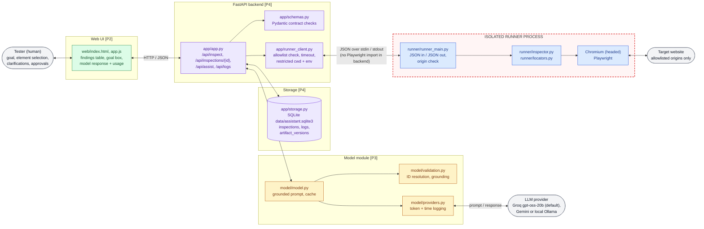

# 1. Component diagram

Source: [`docs/diagrams/component.mmd`](../diagrams/component.mmd). Colours show ownership: P1 blue, P2 green, P3 amber, P4 purple. The red dashed box is the isolated runner process.

## Components

| Component | Files | Owner | Responsibility |
|---|---|---|---|
| Web UI | `web/index.html`, `web/app.js`, `web/style.css` | P2 | URL input, findings table linked to the source URL, element selection, goal box, model response with usage. |
| FastAPI backend | `app/app.py` | P4 | The only entry point. Orchestrates runner, storage and model; maps errors to HTTP codes (400, 404, 501, 503, 504). |
| Contract checks | `app/schemas.py` | P4 | Pydantic models for every request and stored record (see `contracts/api.md`). Runner output is validated before it is saved. |
| Runner client | `app/runner_client.py` | P4 | Allowlist check, spawns the runner as a separate process with a timeout, restricted working folder and minimal environment. |
| Storage | `app/storage.py` | P4 | SQLite: inspections, model-call logs, artifact versions. See [storage design](04-storage-design.md). |
| Runner | `runner/runner_main.py`, `runner/inspector.py`, `runner/locators.py` | P1 | Separate process. Reads one JSON request on stdin, opens headed Chromium, returns elements and ranked locators with match counts on stdout. |
| Model module | `model/model.py`, `model/validation.py`, `model/providers.py` | P3 | Builds the grounded prompt, calls the provider, checks output grounding, records tokens and time. |
| LLM provider | external / local | P3 | Groq `openai/gpt-oss-20b` by default; Gemini or local Ollama as alternatives. |

## Boundaries

- **Isolation boundary.** The backend never imports Playwright or `runner/` code. It exchanges only JSON with the runner over stdin/stdout. A crash, hang or timeout in the browser cannot take down the API.
- **Trust boundary.** Everything read from the target page (labels, text, attributes) is untrusted. It is validated by schema, truncated, and placed inside a delimited untrusted-data block before reaching the model.
- **Secrets boundary.** API keys live only in a local, git-ignored `.env`. The runner process does not receive them (environment allowlist in `runner_client.py`).
