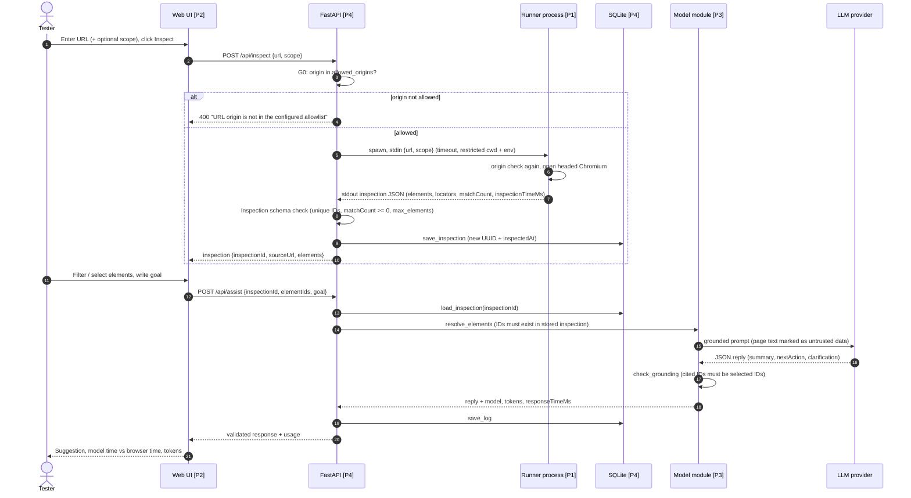

# 2. Phase 1 data flow

Source: [`docs/diagrams/dataflow.mmd`](../diagrams/dataflow.mmd).

## Data-flow table

| # | Step | Component | Data passed on |
|---|---|---|---|
| 1 | Tester enters a URL (optionally a scope: CSS selector and element types) and clicks **Inspect**. | Web UI | `POST /api/inspect` `{url, scope}` |
| 2 | Backend checks scheme, credentials-in-URL and origin against `allowed_origins` (gate G0). Refused URLs never start a browser. | Backend (`runner_client.check_allowed_url`) | 400 on refusal |
| 3 | Backend spawns the runner process with `{url, scope}` on stdin, a timeout, working folder `data/runner_work/` and an environment without API keys. | Backend → Runner | JSON request |
| 4 | Runner re-checks the origin, opens visible Chromium, extracts interactive elements, labels, attributes and candidate locators with live match counts, and measures browser time. | Runner | inspection JSON on stdout, `inspectionTimeMs` |
| 5 | Backend validates the output (`Inspection` schema: unique element IDs, `matchCount >= 0`, derived `unique`, `max_elements`). Invalid output is rejected and not stored. | Backend (`schemas.py`) | validated snapshot |
| 6 | Backend saves the snapshot with a new UUID and `inspectedAt` timestamp, and returns it. | Storage | `inspectionId`, elements, `sourceUrl` |
| 7 | UI shows the findings linked to the source URL. Tester filters and selects elements and writes a testing goal, then clicks **Ask**. A saved inspection can be reloaded with `GET /api/inspections/{id}` without opening the browser again. | Web UI | `POST /api/assist` `{inspectionId, elementIds, goal, clarificationAnswer?}` |
| 8 | Backend loads the stored inspection; `resolve_elements` accepts only IDs that exist in it. | Backend + Model | selected element records |
| 9 | Model module builds the grounded prompt (page text delimited as untrusted data) and calls the provider. | Model → LLM | prompt |
| 10 | LLM returns structured JSON: summary, observations, next action or a clarification question. | LLM | reply text |
| 11 | `check_grounding` flags any element ID the reply cites that was not selected. Unparseable replies are reported with the raw text. | Model (`validation.py`) | validated reply + grounding report |
| 12 | Backend saves the call log (goal, IDs, model, tokens, real or estimated, response time, cache flag) and returns the response. | Storage → Web UI | `logId`, response, usage |
| 13 | UI shows the suggestion, model time vs browser time and token counts. `GET /api/logs` returns every call and the average fresh response time. | Web UI | usage evidence |

**Current status:** steps 2, 3, 5, 6 and 8 to 13 are implemented and tested. The API already accepts and stores `scope`; the UI scope field (P2) and the runner reading `scope` and extracting elements in step 4 (P1, `runner/inspector.py`) are still in progress.

## Error paths

| Situation | Response |
|---|---|
| URL not allowlisted, bad scheme, user/password in URL | 400, runner never started |
| Runner exceeds `runner_timeout_seconds` | 504 "Inspection timed out" |
| Runner returns an error or no valid JSON | 400 with the runner error or the last 500 characters of stderr |
| Runner output breaks the contract or exceeds `max_elements` | 400, nothing stored |
| Unknown or malformed inspection ID | 404 |
| Selected ID not in the stored inspection | 400 |
| Provider down, rate-limited or missing key | 503 |
