# 3. Approval gates (G0 to G4)

The assistant never acts on the target site or the test code without a human decision. Each gate is a point where the workflow stops until the tester approves. Source: [`docs/diagrams/gates.mmd`](../diagrams/gates.mmd).

```mermaid
flowchart LR
  URL["Tester enters URL"] --> G0{{"G0 Target approval<br/>allowlisted origin"}}
  G0 -->|approved| INSP["Inspection<br/>(stored snapshot)"]
  G0 -->|refused| STOP0(["400, browser never opens"])
  INSP --> GEN["Draft test cases<br/>(stored element IDs only)"]
  GEN --> G1{{"G1 Test plan approval<br/>edit / clarify / approve"}}
  G1 -->|approved| CODE["Generate POM code<br/>+ syntax and locator checks"]
  G1 -->|changes| GEN
  CODE --> G2{{"G2 Code review"}}
  G2 -->|approved| G3{{"G3 Execution approval<br/>explicit go"}}
  G2 -->|changes| CODE
  G3 -->|go| RUN["Run in isolated runner<br/>store outcome + screenshots"]
  RUN --> RESCAN["Rescan page<br/>diff vs stored inspection"]
  RESCAN --> REP["Proposed locator repairs<br/>with evidence"]
  REP --> G4{{"G4 Repair approval<br/>one repair at a time"}}
  G4 -->|approved| CODE
  G4 -->|rejected| KEEP(["Keep current code,<br/>flag test"])

  classDef gate fill:#fee2e2,stroke:#b91c1c,color:#7f1d1d
  classDef phase1 fill:#ede9fe,stroke:#6d28d9,color:#4c1d95
  class G0,G1,G2,G3,G4 gate
  class URL,INSP phase1
```

| Gate | Phase | What the tester approves | What is checked before the tester sees it | Status |
|---|---|---|---|---|
| **G0 Target approval** | 1 | The target page. Only origins listed in `config/settings.yaml` → `allowed_origins` can be opened; the tester starts each inspection explicitly with **Inspect**. | Scheme is http/https, no username/password in the URL, origin in the allowlist. Checked twice: in the backend before spawning (`runner_client.check_allowed_url`) and again inside the runner (`runner_main.validate_url`). Redirect/navigation blocking is done in the inspector (P1). | Enforced in code |
| **G1 Test plan approval** | 2 | Generated test cases (steps and expected results). The tester can edit them, answer clarification questions, or approve. | Every step references stored element IDs only; missing expected behaviour becomes a clarification question instead of a guess. | Planned |
| **G2 Code review** | 2 | Generated Playwright Page Object Model code. | Python syntax check; each locator re-checked against the stored inspection (`matchCount == 1`). The tester sees the code and a diff against the previous version. | Planned |
| **G3 Execution approval** | 2 | An explicit "run" before any test executes. | Only approved code versions can run; execution uses the same isolated runner and allowlist. | Planned |
| **G4 Repair approval** | 2 | Each proposed locator repair, one at a time, with its evidence (old locator, new candidate, match count, diff of the rescanned element). | Rescan diff: added, removed, changed elements; ambiguous matches are asked about, never chosen silently. | Planned |

## Human interaction already in Phase 1

- **Scope:** the tester can restrict inspection to a CSS selector and element types (`scope` in `POST /api/inspect`).
- **Selection:** the model only receives the elements the tester selected, resolved from the stored inspection.
- **Clarification:** when the model cannot know the expected behaviour it asks one question; the tester's answer is sent back as `clarificationAnswer`.
- **Visibility:** every model answer shows its grounding report (unknown IDs are flagged, not hidden), token counts and timing.

## Where approvals will be stored (Phase 2)

Each approved test plan and code version is saved with `storage.save_version(...)` in `artifact_versions`, so the approved state is exactly reproducible and earlier versions can be restored. Planned `runs` and `repairs` tables record G3 and G4 decisions (see [storage design](04-storage-design.md)).
