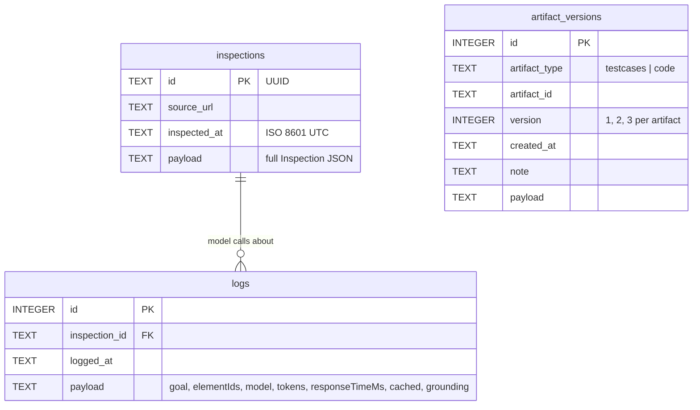

# 4. Storage design

Implemented in `app/storage.py` with SQLite. The database file is `data/assistant.sqlite3`; the `data/` folder is git-ignored, so no run data is committed.

## Why SQLite

- Single file, part of the Python standard library: no server to install, works from a fresh clone.
- Enough for one tester on one machine (the Phase 1 and Phase 2 use case).
- Each record keeps the full JSON payload plus a few indexed columns, so the contract can grow without schema changes, while lookups by ID, URL or inspection stay in SQL.

## Tables (implemented)

| Table | Written by | Read by | Notes |
|---|---|---|---|
| `inspections` | `save_inspection` after `POST /api/inspect` | `load_inspection` (`GET /api/inspections/{id}`, `/api/assist`), `list_inspections(source_url)` | Each inspection is an immutable snapshot with a new UUID and `inspectedAt`. A rescan creates a new row, so old snapshots stay available for comparison. |
| `logs` | `save_log` after every `/api/assist` call | `list_logs(inspection_id)` (`GET /api/logs`) | One row per model call: goal, selected IDs, provider, model, input/output tokens (flagged when estimated), response time, cache flag, grounding result. |
| `artifact_versions` | `save_version` | `list_versions`, `get_version` | Ready for Phase 2 test cases and code. `UNIQUE(artifact_type, artifact_id, version)`. Restore = save an old payload again as a new version, so history is never rewritten. |

## Reliability

- **Transactions:** every access goes through `connect()`, which commits on success, rolls back on any error and always closes the connection.
- **Validation before writing:** runner output is validated by the `Inspection` schema first; invalid output is never stored.
- **IDs:** inspection IDs are checked as UUIDs before any query; malformed IDs return 404.
- **Migrations:** databases created by the first starter version are upgraded in place: missing columns are added and filled from the stored JSON with `json_extract`.
- **Legacy files:** old `data/<UUID>.json` snapshots are still readable by `load_inspection`.

## Planned for Phase 2 (not created yet)

| Table | Purpose | Main columns |
|---|---|---|
| `runs` | Each approved test execution (G3) | `id`, `code_version_id`, `inspection_id`, `approved_at`, `started_at`, `finished_at`, `status`, `payload` (per-test outcome, failure details, screenshot paths) |
| `repairs` | Each proposed locator repair and the tester decision (G4) | `id`, `run_id`, `old_inspection_id`, `new_inspection_id`, `element_id`, `status` (proposed / approved / rejected), `decided_at`, `payload` (old and new locator, evidence) |

Screenshots will be stored as files under `data/` with their paths in the `runs` payload, not as blobs in SQLite.
