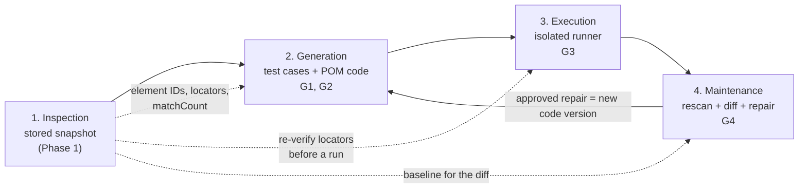

# 5. Path from inspection to generation, execution and maintenance

The stored inspection is the single source of truth for every later phase. Nothing downstream may invent an element: test cases, code, runs and repairs all point back to element IDs and locators that were observed and stored.

## 1. Inspection (Phase 1, implemented)

Output: an `Inspection` snapshot in the `inspections` table with `inspectionId`, `sourceUrl`, `inspectedAt`, optional `scope`, and elements with role, label, attributes and ranked candidate locators carrying `matchCount` and `unique`.

## 2. Generation (Phase 2)

- **Test cases.** The tester's requirement and the stored inspection go to the model. Every step must cite stored element IDs; the same `resolve_elements` and `check_grounding` checks used in Phase 1 reject unknown IDs. Unknown expected behaviour becomes a clarification question. → **G1** test plan approval, saved as a `testcases` version.
- **Code.** Page Object Model classes are built from stored locators. Locators already known to be unique (`matchCount == 1`) are preferred, so ambiguity is solved before code exists. The code is syntax-checked and each locator re-checked. → **G2** code review, saved as a `code` version; the tester can diff and restore versions.

## 3. Execution (Phase 2)

- Only an approved code version can run, and only after an explicit **G3** go.
- The run uses the same isolated runner process and allowlist as inspection.
- Before running, locators are re-verified against the live page; a mismatch is reported instead of running a broken test.
- Outcomes, failure details and screenshots are stored in the planned `runs` table.

## 4. Maintenance (Phase 2)

- When the page changes, the tester triggers a rescan. It produces a new snapshot; the old one is kept.
- The previous snapshot of the same page is found with `storage.list_inspections(source_url)` (newest first).
- The two snapshots are compared: **added**, **removed** and **changed** elements (label, attributes, locator match counts).
- For broken locators, repair candidates are proposed from the new snapshot with their evidence. Ambiguous matches are asked about.
- Each repair needs **G4** approval and produces a new `code` version, which goes back through code review.

## What each phase reuses from the inspection

| Later phase | Reuses | Why it matters |
|---|---|---|
| Test design | Stored element IDs | Cases are grounded; the model cannot reference elements that do not exist. |
| Code generation | Stored locators + `unique` | POM code uses locators already proven to match exactly one element. |
| Execution | Stored locators as the expected state | Drift is detected before a run instead of producing false failures. |
| Maintenance | The previous snapshot as the baseline | Changes are computed, not guessed, and every repair has evidence. |
